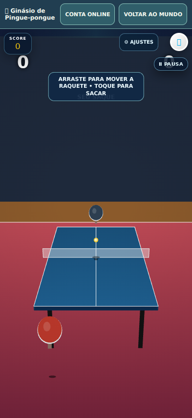
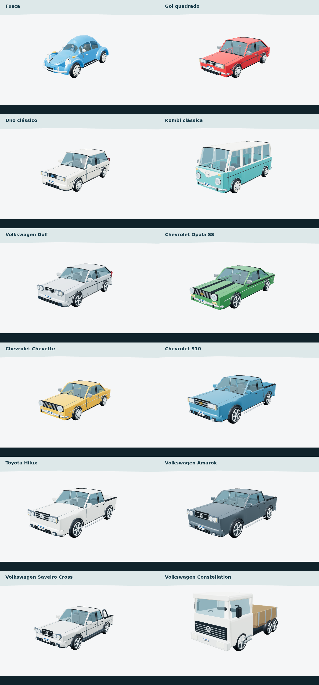
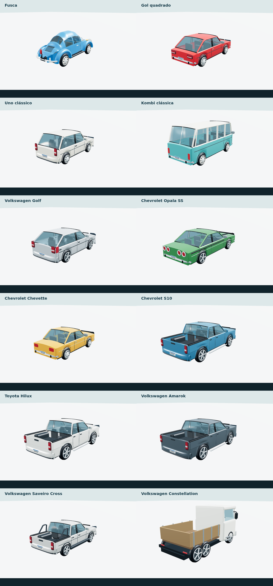
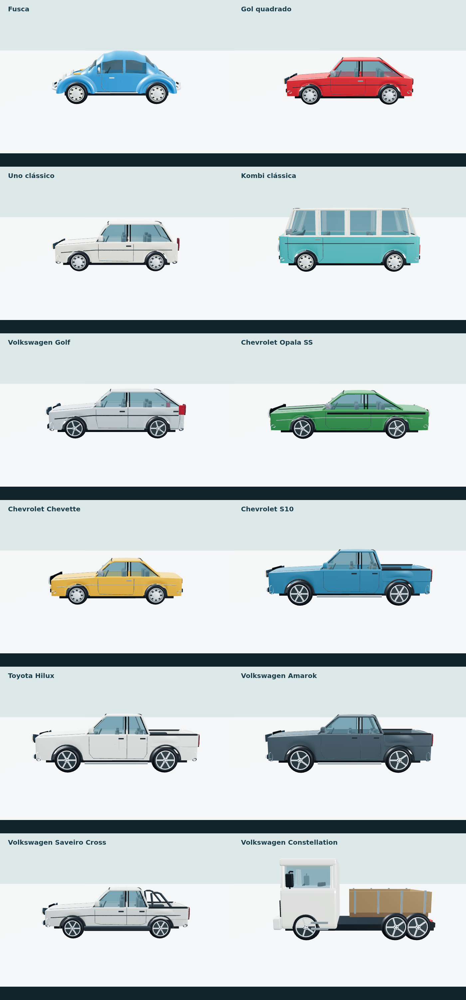

# Ginásio de pingue-pongue e carrocerias brasileiras

Release: `705.22.1-venues-coachwork` · revisão `5e8f4018347fd162`.
Fonte publicada: `cc8eea25f780d834f61ccaee8f287bcd222215f8`.

## Problema e comportamento entregue

A foto 319771.jpg mostra `ERR_FAILED` na navegação do mundo para `/games/tenis/?otVenue=…&venuePage=1`. Uma requisição HTTP 200 no servidor não reproduz nem comprova a solução dessa condição no aparelho do usuário.

O ginásio agora carrega o HTML original de tênis de mesa numa atividade dentro do próprio mundo. O documento usa a pasta original como base para seus scripts, controles e recursos. Não há uma segunda implementação da física ou do jogo. A cidade permanece pausada e deixa de renderizar enquanto a atividade está aberta. O botão Voltar ao mundo e o histórico do navegador fecham a atividade e retomam a posição e a família. Falha de rede mantém a interface de retorno e oferece Tentar novamente, em vez de abandonar a cidade numa navegação sem recuperação.

O token e a origem são verificados nas mensagens da atividade; documentos `srcdoc` usam a origem de sua base confiável, evitando o valor literal `null` de `location.origin`. A troca entre Solo e Conta online continua disponível no cabeçalho. Ela reutiliza `ConsolePractice.account/enter`, preservando as regras e os perfis originais. Fechar a atividade salva a prática e encerra o jogo e seus sensores.

O worker do mundo agora respeita sua própria pasta. Recursos de outro jogo não recebem o índice offline da cidade.

## Veículos

Dez carrocerias receberam superfícies indexadas com curvas, capôs e tetos abaulados, vidros, frentes por geração, lanternas, caçambas abertas e detalhes distintos. O Golf recebeu perfil de hatch; a inclinação da traseira do Uno foi ajustada. O Fusca foi mantido, com largura revista e avental dianteiro fechado. Rodas e acabamento foram revistos nos doze tipos, incluindo o caminhão. Um mapa de reflexão procedural de 128 pixels é compartilhado pelas instâncias; geometria e materiais fixos continuam em cache, com pintura independente por veículo.

São representações 3D autorais. Esta entrega melhora formas e identificação visual, mas não comprova réplica exata, fidelidade de fábrica ou uma nota de qualidade. Não usa CAD de fabricantes, extração de outro jogo ou fotos incorporadas como malha.

IDs, compras, cores salvas, família, direção, oficina, veículos remotos e progresso permanecem no motor existente. As representações antigas dos carros ficam ocultas. Motos, kart, avião e helicóptero continuam em seus próprios motores.

## Verificação

| Fluxo | Evidência |
| --- | --- |
| Testes Node | 194 passaram, zero falhas |
| Ginásio | Toques nativos em retrato e paisagem; partida no motor original; raquete responde ao dedo; volta pelo botão e pelo histórico |
| Recuperação | Pedido do documento bloqueado uma vez; mundo permanece disponível; Tentar novamente abre o jogo; zero navegações HTTP da atividade |
| Conta online | Abrir a tela de conta e retornar ao Solo sem autenticar ou alterar uma conta real |
| Outros acessos | Boxe em página própria e tentativa recuperável em desktop |
| Carrocerias | Doze modelos renderizados de frente, lateral e traseira, quatro ou seis rodas, materiais de pintura independentes e geometria compartilhada |
| Frota | Onze modelos de passageiros pela garagem real; dezenove veículos possuídos; família selecionada embarca; cores e compras sobrevivem à reabertura |
| Remotos | Reprodução do protocolo com pintura de outro jogador, sem sobrescrever a cor ou o save local |
| Atualização | Worker anterior, atualização aguardando página pronta, preservação do perfil e reabertura offline do mundo |

Os testes usam Chromium com emulação móvel e renderização por software. Não constituem teste em Android físico, calibração por câmera real ou partida online entre dois aparelhos.

## Capturas reais

Referências de desenho consultadas: [Volkswagen Golf IV](https://www.volkswagen-newsroom.com/en/golf-4-19972003-19476), [Toyota Hilux 2012](https://media.toyota.co.uk/hilux-2012-new-design-and-more-power-2/). Os recursos visuais distribuídos são autorais.

## Publicação verificada

Vercel `dpl_7F82b3o4UjprD3qdDAj12nii4F1y`: READY, origem `cc8eea25f780d834f61ccaee8f287bcd222215f8`, alias público atribuído sem erro. Os 31 arquivos protegidos do mundo e os dois documentos de integração do tênis de mesa tiveram SHA-256 igual ao estado testado. No endereço público, os cenários móveis de entrada normal e pedido bloqueado seguido de nova tentativa passaram, com partida original, retorno, preservação do perfil e zero erros JavaScript.

O teste de frota foi realizado na revisão `6758b172d6bb3545`; seus construtores, pinturas, garagem e assentos não mudaram na correção final do cabeçalho. Os testes de ginásio, 194 testes Node e atualização real do worker foram repetidos na revisão final `5e8f4018347fd162`.
